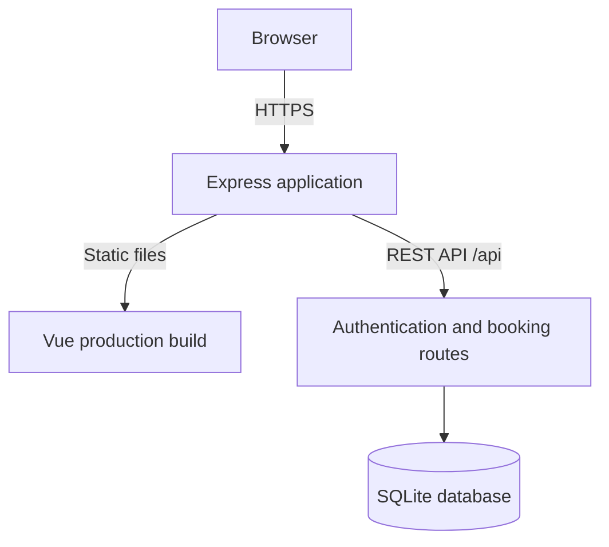

# Cinema Booking System

A full-stack **educational cinema ticket booking application** built with **Vue 3, Express, Node.js, and SQLite**. Users can browse movies, select showtimes and seats, manage their bookings, and cancel eligible reservations. The project demonstrates full-stack development, authentication, relational database transactions, automated testing, responsive design, and cloud deployment.

> **Demo project:** All movies and bookings are for demonstration purposes. No real tickets are issued and **no real payments are processed**. Please do not use real passwords or sensitive personal information when trying the public demo.

## Live demo

**Website:** Add your Railway HTTPS URL here after verifying the deployment.

**Live Demo:** Currently offline. Follow the instructions below to run locally.

**Source code:** https://github.com/CHS6868/cinema-booking-system

## Features

- **Movie catalogue:** Browse movies, genres, durations, and available showtimes, with movie posters.
- **Showtime and seat selection:** Choose a date and time, view a seat map, and see the booking summary and total price.
- **Account authentication:** Register, sign in, and sign out with hashed passwords and server-side sessions.
- **Personal booking history:** View reservations belonging to the signed-in user only.
- **Booking filters:** Switch between **Upcoming**, **Past**, and **Cancelled** reservations.
- **Booking cancellation:** Cancel a confirmed booking before its showtime; the corresponding seats become available again.
- **Booking consistency:** SQLite transactions and a partial unique index help prevent double booking of confirmed seats.
- **Responsive frontend:** Interfaces designed for desktop, tablet, and mobile viewport widths.
- **Automated testing:** Backend unit/API tests and frontend component tests.

## Technology stack

| Layer | Technology |
| --- | --- |
| Frontend | Vue 3, Vue Router, Vite, JavaScript, CSS |
| Backend | Node.js, Express 5 |
| Database | SQLite via Node.js `node:sqlite` (`DatabaseSync`) |
| Authentication | Scrypt password hashing, HTTP-only session cookies, SQLite-backed sessions |
| Testing | Node.js test runner, Vitest, Vue Test Utils |
| Hosting | Railway (single Express service serving the built Vue frontend) |
| Version control | Git and GitHub |

## Architecture



During local development, Vite runs separately and proxies `/api` requests to Express. In production, Express serves the built Vue assets and the API from the same origin.

## Project structure

```text
cinema-booking-system/
├── backend/
│   ├── auth/                 # Password and session helpers
│   ├── database/             # SQLite schema, initialization, connection
│   ├── routes/               # Booking cancellation route
│   ├── scripts/              # Showtime seeding and production startup
│   ├── tests/                # Backend unit and API integration tests
│   └── server.js             # Express application and API endpoints
├── frontend/
│   ├── public/posters/       # Demo movie images
│   ├── src/components/       # Reusable Vue components
│   ├── src/views/            # Application pages
│   └── vitest.config.js      # Frontend test configuration
├── PHASE8_GUIDE.md
├── PHASE8_TEST_PLAN.md
├── package.json             # Production startup script
└── README.md
```

## Run locally

### Prerequisites

- **Node.js 24.12 or later (24.x recommended)** and npm.
- Git (optional if the project is downloaded as a ZIP).

### 1. Clone and install dependencies

```bash
git clone https://github.com/CHS6868/cinema-booking-system.git
cd cinema-booking-system
npm ci --prefix backend
npm ci --prefix frontend
```

### 2. Start the backend

```bash
npm start
```

The production startup script initializes a new local demo database if required, prepares the authentication/session tables, seeds upcoming showtimes, and starts Express. It uses port **3000** by default.

### 3. Start the frontend development server

Open a second terminal:

```bash
npm run dev --prefix frontend
```

Open **http://localhost:5173**. Vite proxies `/api` calls to **http://localhost:3000**.

**Windows PowerShell note:** If `npm` is blocked by script execution policy, use `npm.cmd` in place of `npm` in the commands above.

### 4. Build the frontend

```bash
npm run build --prefix frontend
```

Vite writes the production frontend to `frontend/dist/`.

## Testing

Run backend automated tests:

```bash
npm test --prefix backend
npm run test:coverage --prefix backend
```

Run frontend component tests and the production build:

```bash
npm test --prefix frontend
npm run test:coverage --prefix frontend
npm run build --prefix frontend
```

The test suites cover scenarios such as showtime validation, authentication, booking ownership, seat availability, cancellation, and Vue component behavior. The precise number of passing tests and coverage percentages depend on the current version; see the test runner output rather than assuming a fixed score.

See [`PHASE8_TEST_PLAN.md`](./PHASE8_TEST_PLAN.md) for the test plan.

## Deployment on Railway

This repository is structured to run the frontend and backend together in one Railway service.

| Railway setting | Configuration |
| --- | --- |
| Repository root | `/` |
| Build command | `npm ci --prefix frontend --include=dev && npm run build --prefix frontend && npm ci --prefix backend --omit=dev` |
| Start command | `npm start` |
| Node.js | 24.x |
| `NODE_ENV` | `production` |
| `TZ` | `Asia/Kuala_Lumpur` |
| `CINEMA_DB_PATH` | `/data/cinema.db` |
| Persistent volume mount | `/data` |

The hosting platform provides the production `PORT` value. The SQLite database **must use persistent storage** to survive redeployments. Do not commit local `.db` files, session records, credentials, or `.env` files to Git.

After deploying, generate a public HTTPS domain in Railway and verify login, booking, cancellation, and data persistence before sharing the demo URL.

## Notes and limitations

- Demonstration movies and showtimes are seeded; **no real inventory or ticket purchase** is involved.
- Payment processing and refunds are **not** implemented.
- SQLite is suitable for this small single-instance demo; a larger production service would need additional operational planning.
- Public deployment requires ongoing attention to authentication security, input validation, rate limiting, CSRF protection, backups, and hosting costs.
- The scheduled demo showtimes may need to be reseeded as dates expire.

## Possible future enhancements

- Email-based booking confirmation and downloadable e-tickets.
- Search, filtering, and sorting in the movie catalogue.
- Administrative management of movies, halls, and showtimes.
- Improved accessibility and expanded automated end-to-end testing.
- Optional **simulated** checkout, without real payments.

## Project purpose

This project was developed as a hands-on software engineering exercise covering the development lifecycle: planning, API development, database integration, authentication, frontend refactoring, testing, and deployment.
